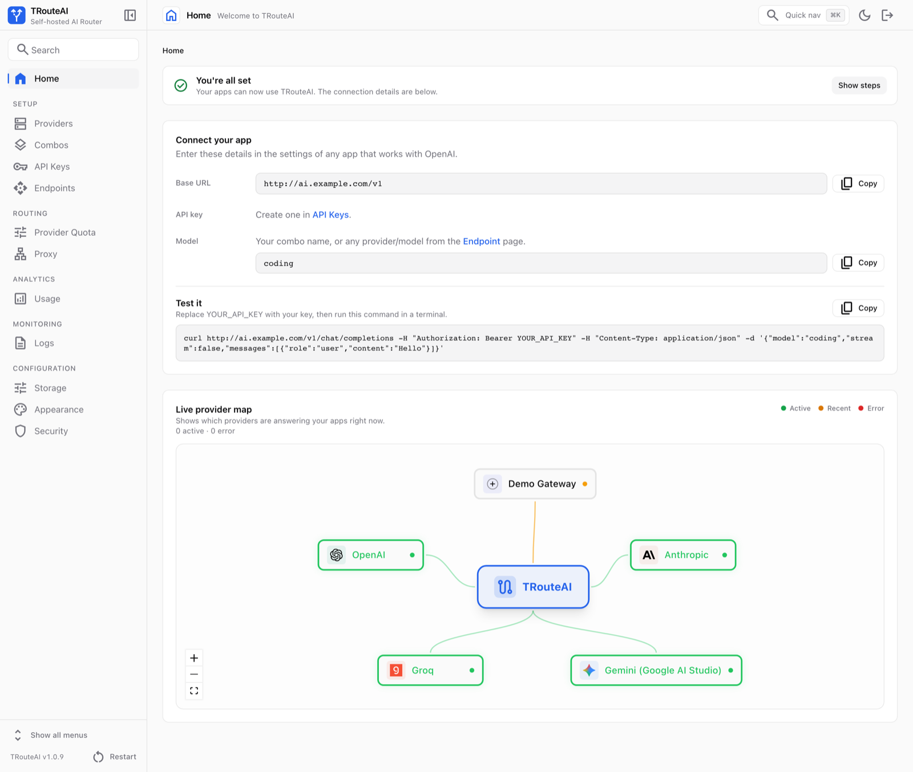
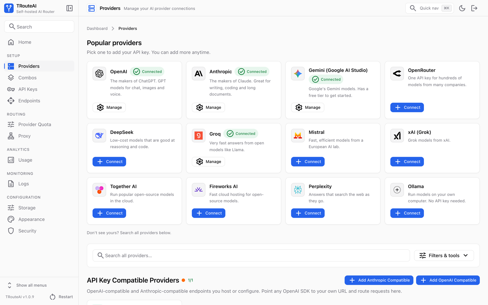
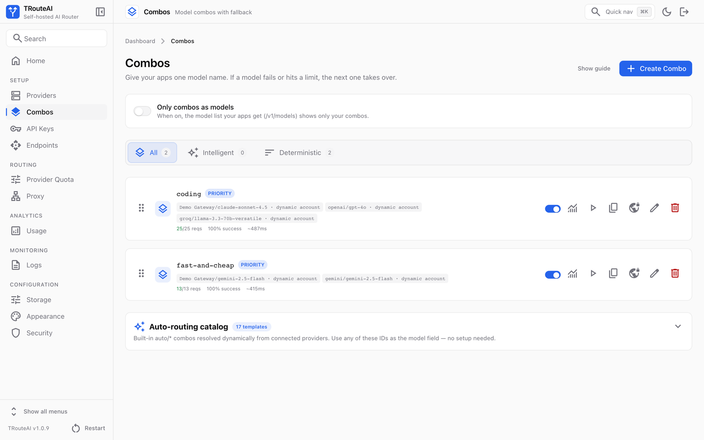
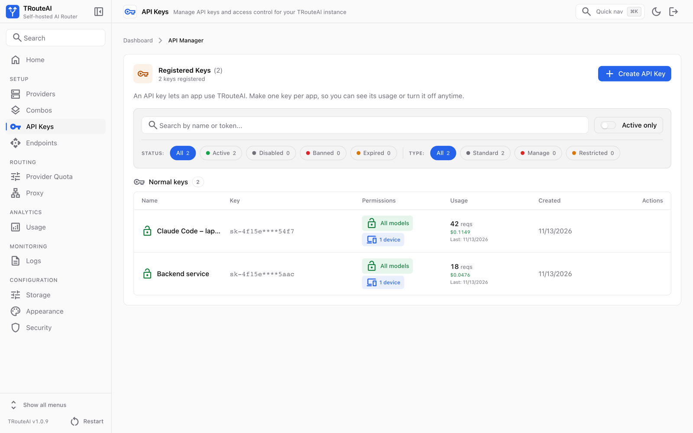
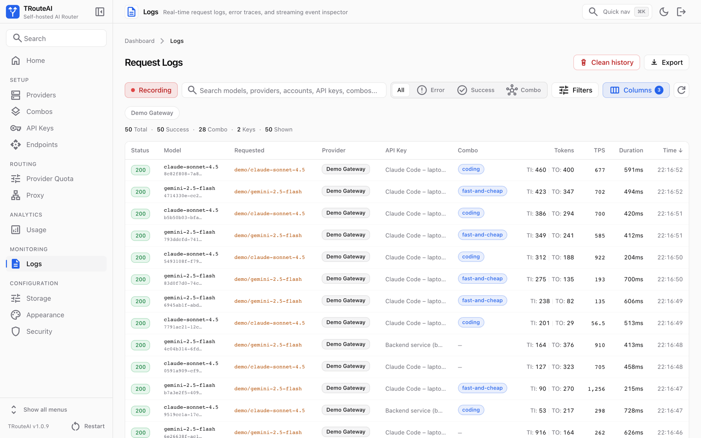
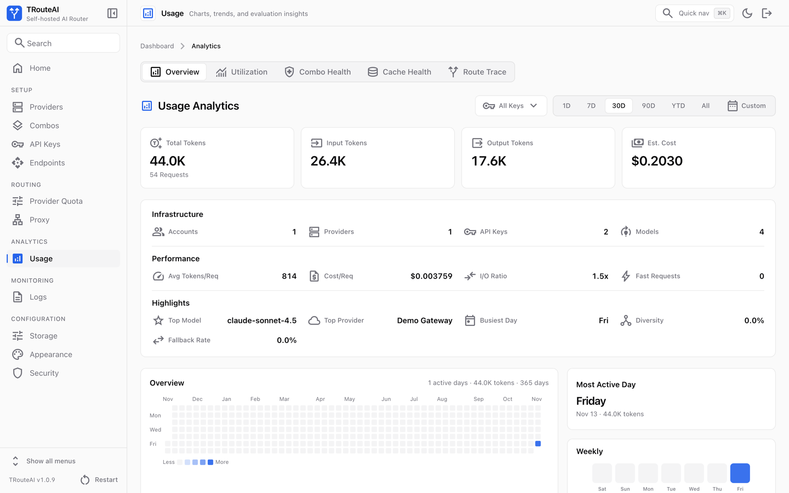
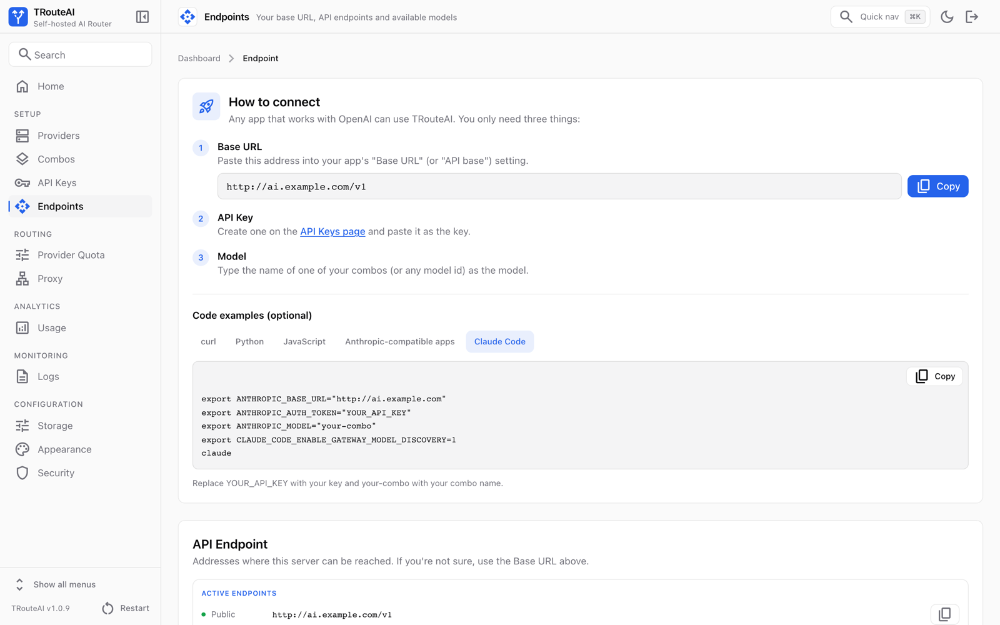

<p align="center">
  
</p>

<h1 align="center">TRouteAI</h1>

<p align="center"><strong>Your AI. Your Models. Your Rules.</strong></p>

<p align="center">
  An open-source, self-hosted AI gateway to route, manage, and optimize multiple LLM providers
  through a single API.
</p>

<p align="center">
  <a href="https://www.npmjs.com/package/trouteai"></a>
  <a href="https://www.npmjs.com/package/trouteai"></a>
  <a href="https://github.com/allswebtech/trouteai/actions/workflows/ci.yml"></a>
  <a href="https://www.npmjs.com/package/trouteai"></a>
  <a href="https://github.com/allswebtech/trouteai/blob/main/LICENSE"></a>
</p>

<p align="center">
  <a href="#screenshots">Screenshots</a> ·
  <a href="#install">Install</a> ·
  <a href="#connect-your-apps">Connect your apps</a> ·
  <a href="#host-it-on-a-server">Host it on a server</a> ·
  <a href="#settings">Settings</a> ·
  <a href="#faq">FAQ</a> ·
  <a href="https://github.com/allswebtech/trouteai/blob/main/CHANGELOG.md">Changelog</a> ·
  <a href="https://github.com/allswebtech/trouteai">GitHub</a>
</p>

Add your AI providers once in a web dashboard, create API keys, and point any OpenAI- or
Anthropic-compatible app at one base URL: Claude Code, Codex CLI, the OpenAI and Anthropic SDKs,
and other tools. A **combo** is one model name that tries several provider models in order, or
with another routing strategy, and falls back on errors and usage limits.

```text
 Claude Code ─┐                               ┌─► OpenAI
 Codex CLI   ─┤                               ├─► Anthropic
 Your app    ─┼─►  TRouteAI  (one /v1 API) ───┼─► Gemini, Groq, Mistral, …
 Any SDK     ─┘    keys · combos · fallback   └─► any OpenAI- or Anthropic-compatible server
                   usage limits · logs
```

**Status: stable.** 1.0.9 is the first stable release. Versions 1.0.0 to 1.0.8 were beta
releases; if you run one of them, update with `trouteai update`.

## Quick start

```bash
npm install -g trouteai
trouteai
```

Open <http://localhost:20017> and sign in with the first password (the terminal shows where it is
saved). Add a provider, create an API key, and point your app at `http://localhost:20017/v1`.
[Install](#install) has the details, [Host it on a server](#host-it-on-a-server) the steps for a
server.

<p align="center">
  <picture>
    <source media="(prefers-color-scheme: dark)" srcset="https://github.com/allswebtech/trouteai/raw/main/docs/images/dashboard-home-dark.png">
    
  </picture>
</p>

## Why TRouteAI

- **One API for every provider.** OpenAI format (`/v1/chat/completions`, `/v1/responses`,
  `/v1/models`, embeddings, images, audio) and Anthropic format (`/v1/messages`). 290+ built-in
  providers by API key or account sign-in, plus any OpenAI- or Anthropic-compatible server.
- **Combos with fallback.** In order, round robin, weighted, cost-optimized and 15 more routing
  strategies. An account whose usage limit (5-hour, weekly, daily) is used up is skipped without
  a request until it resets, then used again by itself.
- **Made for coding agents.** Claude Code model discovery, effort and thinking settings passed
  through, the conversation sent exactly as the client built it, and context-limit errors
  returned in the wording the agent recovers from (it compacts and goes on).
- **Lite and private.** Runs on your computer or server (Node.js and SQLite), near-zero CPU when
  idle, provider credentials encrypted at rest, no telemetry, a random admin password on first
  start.
- **Easy, and yours.** One `npm install -g`, a clean dashboard with light and dark themes, and
  your own app name, logo and credit line.

## Works with

**Apps:** Claude Code, Codex CLI, the OpenAI and Anthropic SDKs (Python, JavaScript and others),
curl, and any tool that lets you set an OpenAI or Anthropic base URL.

**Providers:** OpenAI, Anthropic, Google Gemini, OpenRouter, DeepSeek, Groq, Mistral, xAI (Grok),
Together AI, Fireworks AI, Perplexity, Ollama on your own computer, and 290+ more by API key or
account sign-in. Any OpenAI- or Anthropic-compatible server can be added as a custom provider.

## Screenshots

<table>
  <tr>
    <td width="50%" valign="top">
      <a href="https://github.com/allswebtech/trouteai/raw/main/docs/images/providers.png"></a>
      <br><b>Providers.</b> Pick a provider and paste its API key, or sign in with an account.
    </td>
    <td width="50%" valign="top">
      <a href="https://github.com/allswebtech/trouteai/raw/main/docs/images/combos.png"></a>
      <br><b>Combos.</b> One model name for your apps, with backup models behind it.
    </td>
  </tr>
  <tr>
    <td width="50%" valign="top">
      <a href="https://github.com/allswebtech/trouteai/raw/main/docs/images/api-keys.png"></a>
      <br><b>API keys.</b> One key per app, so you can see its usage or turn it off anytime.
    </td>
    <td width="50%" valign="top">
      <a href="https://github.com/allswebtech/trouteai/raw/main/docs/images/logs.png"></a>
      <br><b>Logs.</b> Every request with its model, provider, combo, tokens and time.
    </td>
  </tr>
  <tr>
    <td width="50%" valign="top">
      <a href="https://github.com/allswebtech/trouteai/raw/main/docs/images/analytics.png"></a>
      <br><b>Usage.</b> Requests, tokens and estimated cost, for all keys or one.
    </td>
    <td width="50%" valign="top">
      <a href="https://github.com/allswebtech/trouteai/raw/main/docs/images/endpoint.png"></a>
      <br><b>Endpoints.</b> Copy-paste setup for curl, Python, JavaScript and Claude Code.
    </td>
  </tr>
</table>

## Install

You need [Node.js](https://nodejs.org) 26 (recommended), 24, or 22.22.2 and newer.

```bash
npm install -g trouteai --allow-scripts=tls-client-node,koffi --loglevel=error
trouteai
```

The extra options keep the install quiet and let the two TLS helpers of the browser-session
providers (ChatGPT Web, Claude Web, Grok Web, Perplexity Web) finish their setup. Plain
`npm install -g trouteai` works too; newer npm versions then print a note about install scripts.

Open <http://localhost:20017> and sign in. On the first start TRouteAI creates a random
dashboard password and saves it to `initial-admin-password.txt` in the data folder (the start
screen shows the exact path). Stop TRouteAI with `Ctrl+C`.

| Command                          | What it does                 |
| -------------------------------- | ---------------------------- |
| `trouteai`                       | Start TRouteAI               |
| `trouteai --port 20018`          | Start on another port        |
| `trouteai config`                | Show your settings           |
| `trouteai config set PORT 20018` | Change a setting             |
| `trouteai reset-password`        | Set a new dashboard password |
| `trouteai update`                | Update to the latest version |
| `trouteai uninstall`             | Remove TRouteAI              |
| `trouteai --help`                | All commands and options     |

`trouteai update` installs the latest version with a progress line (stop TRouteAI first).
`trouteai uninstall` removes TRouteAI; it keeps your data folder unless you answer yes.

### Settings

All settings are in one file, `.env` in the data folder (`~/.trouteai/.env`; on Windows
`%APPDATA%\trouteai\.env` unless `~/.trouteai` exists). `trouteai` creates it on the first start:

| Setting                | Default   | Meaning                                                                      |
| ---------------------- | --------- | ---------------------------------------------------------------------------- |
| `PORT`                 | `20017`   | Port for the dashboard and the API                                           |
| `HOST`                 | `0.0.0.0` | `0.0.0.0` = this computer and your network, `127.0.0.1` = only this computer |
| `INITIAL_PASSWORD`     | empty     | Password for the first login (8+ characters); empty = random password file   |
| `REQUIRE_API_KEY`      | `true`    | Apps must send an API key created in the dashboard                           |
| `NEXT_PUBLIC_BASE_URL` | empty     | Your public address behind a domain, for example `https://ai.example.com`    |

Edit the file or run `trouteai config set KEY VALUE`, then restart TRouteAI. Command-line
options win over environment variables, which win over the file. `--data-dir <folder>` (or the
`DATA_DIR` environment variable) keeps settings and data in another folder. Secret keys are
generated automatically in `server.env` next to the settings file; keep both files private.

The terminal shows only warnings and errors. `trouteai --verbose` (or `APP_LOG_LEVEL=info`) shows
every message; all logs are also written to `logs/` in the data folder. The app log rotates at
10 MB and keeps 3 old files (`APP_LOG_MAX_FILE_SIZE`, `APP_LOG_MAX_FILES`). Request detail files
are kept 7 days and at most 300 MB in total, oldest removed first (`CALL_LOG_RETENTION_DAYS`,
`CALL_LOG_MAX_TOTAL_MB`). `trouteai` limits server memory to 35% of RAM (512 MB to 4 GB); raise
it with `TROUTEAI_MAX_HEAP_MB` if the log shows "JavaScript heap out of memory". `npm start` /
`app.cjs` use `node --max-old-space-size=N` instead.

## Connect your apps

1. Open the dashboard and log in.
2. **Home** shows a short "Get started" checklist that links to each step below. It also shows
   the base URL, API key and model to paste into your app.
3. **Providers** → pick a popular provider and paste its API key, or use **Step-by-step setup**
   (API key, account sign-in, or a custom OpenAI/Anthropic-compatible server).
4. **API Keys** → create an API key (`sk-…`). It is shown once, with copy buttons.
5. **Combos** → create a combo, for example `my-combo` = `openai/gpt-4o-mini` → `anthropic/…`
   ("In order" = try the first model, fall back to the next on errors or limits).
6. Use it from any client (on a server, replace `http://localhost:20017` with your address):

```bash
curl http://localhost:20017/v1/chat/completions \
  -H "Authorization: Bearer sk-your-key" \
  -H "Content-Type: application/json" \
  -d '{"model":"my-combo","stream":false,"messages":[{"role":"user","content":"Hello"}]}'
```

- OpenAI-compatible base URL: `http://localhost:20017/v1` (`/chat/completions`, `/responses`,
  `/models`, `/embeddings`, `/images/generations`, `/audio/*`, …)
- Anthropic-compatible: `http://localhost:20017/v1/messages` with header `x-api-key: sk-your-key`
- `model` can be a combo name or a `provider/model` id from `GET /v1/models`
- Requests without `"stream"` are streamed by default; send `"stream": false` for a JSON reply
  (or switch the key to JSON mode in **API Keys**)

The sidebar starts with a **simple menu** (main pages only). Use **Show all menus** at the
bottom of the sidebar to see every page.

### Claude Code

```bash
export ANTHROPIC_BASE_URL="http://localhost:20017"      # no /v1: Claude Code adds /v1/messages
export ANTHROPIC_AUTH_TOKEN="sk-your-key"
export ANTHROPIC_MODEL="my-combo"
export CLAUDE_CODE_ENABLE_GATEWAY_MODEL_DISCOVERY=1      # /model lists your TRouteAI models
claude
```

The **Endpoint** page in the dashboard shows these lines with your own address, and examples
for curl, Python, JavaScript and the Anthropic API.

### OpenAI SDKs and Codex CLI

Use `http://localhost:20017/v1` as the base URL and an API key from the dashboard; the model is
a combo name or a `provider/model` id. Codex CLI talks to `/v1/responses`.

## Host it on a server

### SixPanel (recommended)

[SixPanel](https://www.allsweb.com/sixpanel) is a free hosting control panel that turns a server
you rent (a VPS) into your own hosting platform. It installs TRouteAI straight from npm:

- Nothing is built on the server. A deploy downloads the prebuilt `trouteai` package, checks it
  against the checksum npm publishes and installs it in about 15 seconds.
- Nothing to configure. The package carries its own
  [`sixpanel.json`](https://github.com/allswebtech/trouteai/blob/main/sixpanel.json): the start
  command, the health check, the data folder to keep and the secret keys to generate.
- HTTPS is free and renews itself.
- The data folder is kept between deploys and is part of SixPanel's backups.
- A new version goes live only after it answers, and you can roll back from the **Deploys** page.

You need a fresh Ubuntu 26.04 LTS (recommended), Ubuntu 24.04 LTS or Debian 13 server (x86_64 or
arm64) with root access and at least 1 GB of memory (2 GB recommended), and a domain name pointed
at the server.

1. Install SixPanel as root, as the [install guide](https://www.allsweb.com/sixpanel/docs/install)
   explains:

   ```bash
   curl -fsSL https://installer.allsweb.net/sixpanel/install.sh | sudo bash
   ```

2. In SixPanel, open **Projects**, press **Create a new project** and choose **Node.js app**.
   Under **Where is the code?** choose **From an npm package** and type `trouteai`. SixPanel
   installs and starts it by itself.
3. On **Domain & SSL**, add your domain.
4. Open `https://your-domain` and sign in. The first password is a random one: open the website's
   **Terminal** in SixPanel and read it with `cat .trouteai-data/initial-admin-password.txt`.

`.trouteai-data/` holds the database, logs and backups; SixPanel keeps it between deploys. SixPanel
makes the three secret keys once, on the server, and they never change after that. TRouteAI runs
as one process on purpose: it keeps live connections and timers in its own memory.

**Updates.** When a newer version is on npm, the website's **Deploys** page says so and shows a
**Deploy** button; **Automatic deploys** on the same page installs new versions by itself
(`trouteai update` is not used on SixPanel). To stay on one version, choose it there instead of
`latest`, for example `1.0.9`.

**Password.** To set a new dashboard password, run
`DATA_DIR=.trouteai-data npm exec --no -- trouteai reset-password` in the website's **Terminal**.

**Moving an existing website.** A TRouteAI website made from an uploaded folder or a git branch
can switch: make a backup, then on **Deploys** choose **An npm package** → **Choose a package**
and type `trouteai`.

Everything else about SixPanel is in its [documentation](https://www.allsweb.com/sixpanel/docs).

### Other hosting panels (cPanel "Setup Node.js App", aaPanel, 1Panel, CloudPanel, …)

These panels build TRouteAI from its source code. A Linux build needs about 4.6 GB of memory; on
a smaller server, build on your own computer and upload the result (step 4).

1. Upload the project folder (without `node_modules` and `.build`) and select Node.js 26
   (24 or 22.22.2+ also work).
2. Create `.env` from `.env.example` (`npm install` does this for you) and set:
   - `INITIAL_PASSWORD`: a strong dashboard password (8+ characters). If you leave it empty, a
     random one is generated on first start and saved to `DATA_DIR/initial-admin-password.txt`.
   - `NEXT_PUBLIC_BASE_URL=https://your-domain`: your public URL.
   - `PORT`: the port your panel assigns or proxies to (default `20017`).
   - Optional `DATA_DIR`: where the SQLite database lives (default `~/.trouteai`).
   - Behind a reverse proxy (nginx, Caddy, Cloudflare, or a panel's built-in proxy) that
     terminates HTTPS, set `TROUTEAI_TRUST_PROXY=loopback` (proxy on this machine) or `private`
     (proxy on the LAN). The app then trusts `X-Forwarded-Proto` / `X-Forwarded-For`, so the
     login cookie is marked `Secure` and the real client IP is used for rate limiting and the IP
     filter. Leave it unset only for a direct (no-proxy) deployment, where clients could fake
     those headers. `AUTH_COOKIE_SECURE=true` forces the `Secure` cookie on its own.

   > Upgrading an existing reverse-proxy install? Set `TROUTEAI_TRUST_PROXY` (or
   > `AUTH_COOKIE_SECURE=true`). Earlier versions trusted `X-Forwarded-Proto` unconditionally;
   > it is now gated so a direct public deployment cannot be spoofed.

3. Install dependencies: `npm install` (or the panel's "Run NPM Install" button). If the panel
   installs with `NODE_ENV=production`, use `npm install --include=dev`, because the build
   tools are dev dependencies.
4. Build: `npm run build`. If the server does not have enough memory, run `npm run build`
   on your own machine and upload the generated `.build/` folder instead.
5. Start the app:
   - panels with a **start command**: `npm start`
   - panels with an **application startup file**: `app.cjs`
6. Point the domain at the app port (the panel's reverse proxy / "Node.js app URL") and enable
   SSL. With your own nginx config, keep `proxy_buffering off;` for the app so streaming works.

Restart the app after changing `.env`. Data (database, logs, backups) stays in `DATA_DIR`, so you
can redeploy the code without losing providers, keys or combos.

## Run from source

```bash
git clone https://github.com/allswebtech/trouteai.git
cd trouteai
npm install          # also creates .env from .env.example with generated secrets
npm run build
npm start            # http://localhost:20017
```

Development mode: `npm run dev`. A source checkout reads its settings from the project `.env`.
The tests need no account and no API key: `npm test` after a build (see
[tests/README.md](https://github.com/allswebtech/trouteai/blob/main/tests/README.md)).

## Your own branding

The app shows no third-party branding, sponsor or affiliate links. Change the app name and logo
in **Settings → Appearance**. To show your own credit line in the sidebar footer and on the login
page, set it in `.env` and restart the app:

```bash
BRAND_CREDIT="Your credit line"
BRAND_CREDIT_URL=https://your-website.example   # optional link
```

Leave `BRAND_CREDIT` empty to hide it (the default).

## Security defaults

- The dashboard always requires a password; a first-run setup without a password is only
  possible from the server itself, never from the internet.
- `/v1` requires an API key from the dashboard (`REQUIRE_API_KEY=true`).
- Login attempts are rate-limited; session cookies are `HttpOnly`, `SameSite=Lax`, and `Secure`
  automatically on HTTPS.
- Strict security headers (CSP without eval, HSTS, no framing, no `X-Powered-By`).
- Provider credentials are encrypted at rest (`STORAGE_ENCRYPTION_KEY`, generated on first start).
- The dashboard and the API ask search engines and AI crawlers not to index them.

## Maintenance

- Update: `trouteai update` (stop TRouteAI first). On a hosting panel, deploy again.
- Reset the admin password: `trouteai reset-password` (source checkout: `npm run reset-password`;
  SixPanel: see [above](#sixpanel-recommended))
- Back up the data folder (`~/.trouteai` or your `DATA_DIR`). It holds the database, your
  settings and the key that decrypts your provider credentials.
- Environment variables: see [`.env.example`](https://github.com/allswebtech/trouteai/blob/main/.env.example)
- What changed in each version: [CHANGELOG.md](https://github.com/allswebtech/trouteai/blob/main/CHANGELOG.md)

## Contributing

Bug reports, ideas and pull requests are welcome. [CONTRIBUTING.md](https://github.com/allswebtech/trouteai/blob/main/CONTRIBUTING.md) explains
how to set up the project, where things are and how to check a change. The repository is also
set up for AI coding agents ([AGENTS.md](https://github.com/allswebtech/trouteai/blob/main/AGENTS.md), and `.claude/` for Claude Code).

The source code is on GitHub: [allswebtech/trouteai](https://github.com/allswebtech/trouteai).

Found a security problem? Please report it privately: see [SECURITY.md](https://github.com/allswebtech/trouteai/blob/main/SECURITY.md).

## FAQ

**What is TRouteAI?** An open-source, self-hosted AI router (an LLM gateway): one OpenAI- and
Anthropic-compatible API in front of many AI providers, with API keys, combos (fallback and load
balancing) and usage-limit routing, managed in a web dashboard.

**Is it free?** Yes, MIT licensed. You pay only your AI providers, under your own accounts.

**Where do my keys and prompts go?** Only to the providers you add. TRouteAI runs on your own
machine or server, stores provider credentials encrypted in a local SQLite database, and sends
no telemetry.

**What happens when a provider hits its limit?** In a combo, TRouteAI moves to the next model.
An account whose usage window is used up is skipped without sending it a request until the
window resets. When every account is limited, the client gets `429` with `Retry-After`.

**Does TRouteAI change my conversation?** No. Requests reach the provider as your client built
them. Prompt compression exists, but it is off unless you turn it on in Settings. A request that
is too long for the model gets the error your agent knows how to handle (Claude Code compacts
the conversation by itself).

**Where should I host it?** On your own computer, install it with npm. On a server,
[SixPanel](#sixpanel-recommended) is the easiest way: HTTPS, backups and deploys you can roll
back, with nothing built on the server.

**Which Node.js version do I need?** Node.js 26 is recommended; 24, and 22.22.2 or newer also
work.

**How do I reset the dashboard password?** Run `trouteai reset-password`.

## License

MIT. See [LICENSE](https://github.com/allswebtech/trouteai/blob/main/LICENSE).
